<p align="center"></p>

<h1 align="center">The Last Guardian for PC<br><sub>The Definitive Edition</sub></h1>

<p align="center">
  <a href="https://github.com/tabnul/the-last-guardian-definitive/releases/latest"></a>
  
  <a href="port/LICENSE"></a>
  <a href="https://playported.com/ports/1466-the-last-guardian/"></a>
</p>

<p align="center"><i>A fan project, by fans, for fans.</i></p>

An unofficial Windows and Linux PC port of The Last Guardian (PS4). The game code runs natively on
your CPU. The graphics still go through a translation layer based on the shadPS4 emulator. It adds
DLSS and FSR, frame generation, ultrawide support, an optional texture pack, an in-game graphics menu
and a [photo mode](#photo-mode).
It also brings back many
things the developers cut or hid in the game's files, which you can't find in any other version:
see [Cut and hidden content](#cut-and-hidden-content) and the [full guide](docs/extras.md).

> **Work in progress:** we are bringing back much more that the developers cut, or that the game
> keeps locked behind its trophies. New finds arrive with each release.

No game files are included. You need your own copy, dumped from your own PS4.

**Contents:** [Features](#features) · [Get started](#get-started) · [Graphics](#graphics) · [Photo mode](#photo-mode) ·
[Cut and hidden content](#cut-and-hidden-content) · [Sound](#sound) · [Soundtrack](#soundtrack) ·
[Controllers and languages](#controllers-and-languages) · [For testers](#for-testers) ·
[Building](#building) · [Credits](#credits)

## Features

**Made by us, not in any version of the game:**

- **[Photo mode](#photo-mode):** freeze the world, fly a free camera anywhere and save lossless
  PNG screenshots at full render resolution.
- **[Free camera, live world](#photo-mode):** unfreeze the world and keep the free camera. Watch
  events unfold from any angle you like, or play the game itself from that angle while the camera
  stays where you put it.
- **[ICO horns](#ico-horns-only-in-this-port):** the Horned Apparel outfit finally gives the boy
  Ico's horns. Optional, off by default.
- **[Foxtail toy](#foxtail-toy-only-in-this-port):** the developers cut the boy's foxtail toy
  (nekojarashi, "cat teaser") before release. We remade it: the boy waves it, claps, and Trico
  pounces like a cat. Optional, off by default.
- **[Quit directly](#controllers-and-languages):** quit the game from anywhere with a controller
  combo or the keyboard, no menus. The game's pause menu shows the buttons.
- **[Hide button hints](#controllers-and-languages):** switch the game's button hint boxes off,
  for a clean screen. The tutorial still runs in the background, so nothing is skipped.
- **Trophies:** the game's trophies are unlocked as you play and saved next to your saves. The
  in-game menu's **Trophies** tab lists them, with your unlock dates and the icons from your own
  game files. A pop-up with our own chime is optional (off by default). Trophy names need your
  PS4 trophy key (32 hex digits) in the launcher or the menu; the port does not include it, so
  without the key the trophies are numbered.
- **[Trico Tricks](docs/extras.md#trico-tricks-make-trico-move):** 49 of Trico's own moves on a bar (**F12**) in coloured
  groups, with your own favourites, the poses of the game's press shots and E3 demos, and the
  throw-up animation the developers sealed.
- **[Soundtrack](#soundtrack):** a music player in the launcher with all 100 pieces of the game's
  music, from your own game files.
- **[Start at any point](#for-testers):** over 200 start points, from the first cave to the
  credits. Pick one on the launcher's **Start at…** page, or in game under Extras >
  *Jump to a place*. Your saves are copied first and put back afterwards.
- **[Texture pack generator](docs/texture-pack.md):** the game started out on PS3, and many of its
  textures look rough up close on a modern screen. Our
  [generator](https://github.com/tabnul/ps4-texturepack-generator) builds a 4x texture pack from
  your own copy, with more detail in stone, moss, wood and cloth. Optional, and you can switch
  it on and off while you play. New (experimental): the launcher can build it for you, with
  nothing to install.
- **[Realistic tree shade](#graphics):** the game lights its trees oddly. The inside of a
  crown is as bright as the outside, so the trees look flat and over-exposed, with no shade
  between the layers of leaves. This setting adds that shade, so the crowns get depth. Five
  levels, changed while you play. Optional, off by default.
- **Your own launcher background:** the launcher shows a picture from your game files. To use
  your own, open **Settings** and click **Background picture…** in the Launcher box, then pick a
  PNG or JPG. **Default picture** brings the game's picture back.
- **Benchmark tool:** the launcher's Debug > **Benchmark** tab runs a set of scenes and packs the
  results into one zip, so you can attach it when you report a performance problem.
- **[Controllers](#controllers-and-languages):** remap buttons, dead zones and trigger points,
  a stick drift check and your own button combos.

**Brought back from the game's files**, cut or hidden by the developers
([full guide](docs/extras.md)):

- **Trico's drool:** switched off just before release.
- **Trico's play:** Trico sniffs and paws at the boy. A sealed feature that works as originally
  intended, or on demand from Trico Tricks.
- **Extra Tricos:** up to 8 more next to the boy, the armoured one too.
- **Trico's size:** from half to twice his size.
- **Trico's coat:** thicker fur and feathers, up to 250%, for a fluffy Trico. Just for fun.
- **Trico's helmet:** the armour helmet, a broken one or the other Trico's mask, kept on for the
  whole story. Or no helmet at all.
- **Trico's eyes:** the hidden disco-eye effect, or any colour.
- **Trico's toilet:** he goes right away, in front of you.
- **All treasures:** unlocks every treasure (the boy's outfits, Trico's feathers) and the
  Treasures entry in the options menu, with the developers' own unlock. Off by default. It is
  stored in your save, so your saves are backed up before the first unlock.
- **Cut narrator hints:** the 23 narrator hints the developers cut in September 2016. When you
  seem stuck, the narrator helps again, where they first placed his lines. Off by default: they
  give puzzle solutions away.
- **Developer tools:** their free camera, Tricopilot (self-driving Trico) and their QA menu with
  level select.

**Added by the port:**

- Windows and Linux builds
- DLSS, FSR 4, FSR 3.1 and XeSS anti-aliasing and upscaling, and DLSS or FSR frame generation
- Any resolution including 21:9 ultrawide (32:9 experimental), and 30, 60 or unlocked FPS
- An in-game settings menu (**Insert**) with presets, shadows, field of view, effects, colour and HDR10
- Shader recipes against stutter and calmer wind
- 7.1 surround, output device choice and headphone surround
- [Xbox button icons](#controllers-and-languages) in the game's button hints and Controls screen
- Language packs for 14 languages
- [Packed game files](#get-started): play straight from one ZArchive `.zar` file
  and save about half the disk space (about 26 GB becomes about 12.5 GB)

## Get started

1. Download the latest build from [Releases](https://github.com/tabnul/the-last-guardian-definitive/releases).
2. Put the game files in one folder, with update 01.03, about 25 GB. Supported discs: CUSA03627
   (US), CUSA03745 (EU), CUSA04936 (Korea) and CUSA04943 (China). CUSA04937 (Asia) is accepted
   but untested: the launcher shows a warning, and a report on how it runs is welcome.
   The full list is in [docs/game-files.md](docs/game-files.md). How to dump your own copy:
   [Dumping your own copy](port/packaging/README-player.md#dumping-your-own-copy).
3. For audio, copy `libSceNgs2.sprx` from your PS4 firmware into `system_lib/` next to the executable.
4. Start the launcher, pick the game folder and press **Play**.

**Stuck at 30 FPS?** 60 FPS and Unlocked need the 1.03 game code in `eboot.bin`. The port checks
the exact bytes it changes, so any 1.03 dump works (US or EU, PS4 or PS5 dump tool). When the
check fails, the game safely runs at 30 FPS and the launcher shows a warning next to Play. The
usual cause is a folder where the update was not merged on top of the base game, or an
`eboot.bin` that was already changed by another patch or cheat. Dump the game again with update
01.03 and copy its `eboot.bin` over the old one.

**Save half the disk space:** the port can play the game straight from one packed file. In the
launcher, under Game folder, press **Pack…** to turn the folder into a `.zar` file (about 26 GB
becomes about 12.5 GB, a few minutes), or **.zar…** to pick one you made before. Only the parts the
game asks for are unpacked, while it plays. Keep the folder until a first start works, then you can
delete it. The trade-off: unpacking while playing costs some CPU time, so loads can take a bit
longer and slower CPUs may see short hitches when the game streams new areas. If you have the
space, a plain folder is still the fastest choice.

You need a Vulkan 1.3 graphics card with at least 8 GB of video memory. DLSS needs an NVIDIA RTX
card, FSR 4 a recent card and XeSS a recent card on Windows (best on Intel Arc); FSR 3.1 runs on
any card.

**Error 4551 on Windows 11:** Smart App Control blocks programs without a digital signature, and
this port is not signed. Turn it off under Windows Security > App & browser control > Smart App
Control.

These are the keys and buttons as they come. The game's pause menu (Options) and the help panel in
photo mode show the buttons you have set; change them under Controls in the port's menu or on the
launcher's Controller page.

| Key | In game |
|---|---|
| Insert (R3 + L2) | The port's menu |
| Ctrl+X (hold Share + Options 2 s) | Quit the game (settings and progress saved) |
| F9 (L3 + R3) | Photo mode |
| F8 | Switch between DLSS/FSR and the game's own anti-aliasing |
| F10 | FPS counter |
| F12 | Trico Tricks bar |
| Esc | Release the mouse |

## Graphics

Press **Insert** in game to change settings while you play; the launcher has the same settings.
Each setting shows what the game originally used and what we recommend.

- **Resolution:** the game renders at your window size, 21:9 and 32:9 included. At 21:9 the menus
  and subtitles are laid out for the wider screen. 32:9 is experimental: some overlays and menus
  are still off.
- **Anti-aliasing and upscaling:** DLSS, FSR 4, FSR 3.1 or Intel XeSS, using the game's own
  motion vectors. XeSS (XeSS Native AA, or Quality to Performance) is Windows only: Intel ships it
  as a Windows library, so on Linux the choice is greyed out.
  The default renders at full size and replaces the game's SMAA, which removes most of the
  shimmer on feathers, grass and fences. Quality to Ultra Performance render lower for more FPS,
  while menus and subtitles stay sharp. **F8** switches back to the game's own AA to compare.
  See [port/docs/upscaling.md](port/docs/upscaling.md) and [docs/dlaa.md](docs/dlaa.md).
- **Frame generation:** DLSS (RTX 40 or newer) or FSR 3.1 (any card). It shows one generated frame
  between each pair of real ones, and works with any upscaler setting, the game's own (Built-in)
  included. It needs a game frame rate above 30, so it is off at 30 FPS. Off by default.
- **Frame rate:** 30 (as on PS4), 60 or unlocked. On an RTX 5090, unlocked runs at about 90-120 FPS.
- **Steam Deck (experimental):** a graphics preset in the launcher, next to Stock and
  Recommended, sets the game up for a Steam Deck: 1280x800, 30 FPS, no upscaling, frame
  generation off, and every graphics setting at Stock (as on PS4). It is new and still being tuned: tell us how it runs.
- **Shader stutter:** shaders are prepared at start from shader recipes (from
  [bloodborne_pc](https://github.com/deadinside28/bloodborne_pc) by @deadinside28), so new
  drivers and updates don't bring the stutter back. The port also comes with a shader list: on
  the first start it builds the shaders the game uses in the background, so even places you have
  never visited stutter less. The list holds only build recipes, no game code: the shaders are
  made from your own game files. Loading a stage waits until the build is done, so the first
  start takes a little longer. **Build shaders ahead** (in-game menu, Performance; launcher,
  Advanced settings) turns it off; on by default. When the game still has to build a shader
  the list lacks, it writes one line "Shader recipe (not in list)" into its log (build settings
  only, no game code): posting such a log in an issue helps make the list complete.
- **Wind and grass:** the stock wind looks like a storm on PC. You can set it separately for the
  boy, the trees and Trico; 50% is a breeze. Grass that the game moved only every 4th frame now
  moves every frame, which stops the flicker.
- **Realistic tree shade (only in this port):** in the stock game the tree crowns look flat and
  too bright. The light inside a crown is as strong as outside it, so there is no shadow between
  the layers of leaves. This setting darkens the light inside the crowns, so they get depth. Five
  levels, Off to Extreme, and it changes while you play (Extras page). Off by default. Off (left)
  and Medium (right), full screenshots: [off](docs/screenshots/LEAF_OFF.png) ·
  [medium](docs/screenshots/LEAF_MEDIUM.png)

  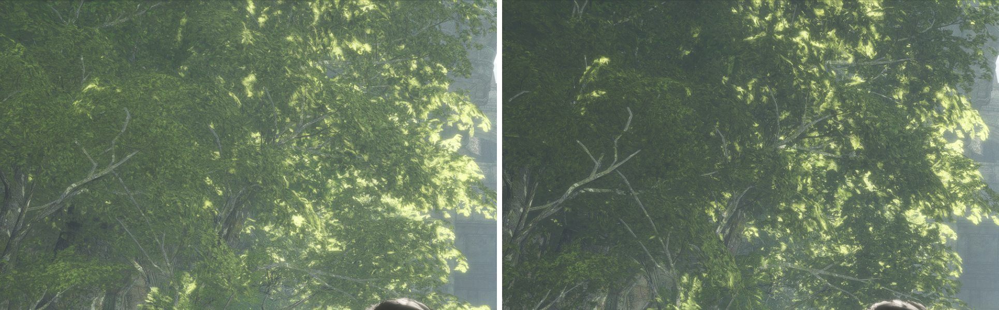
- **Texture pack (optional):** [ps4-texturepack-generator](https://github.com/tabnul/ps4-texturepack-generator)
  makes a 4x texture pack from your own copy. It can be switched on and off while you play.
  **Experimental:** *Image* > *Texture pack* > *Build a texture pack…* in the launcher downloads
  a ready-made kit for NVIDIA, AMD (experimental) or CPU, on Windows and Linux, and builds the pack
  for you. For now it upscales every texture, which needs about 160 GB free while building and
  80 GB for the pack; a lighter build is planned in
  [issue #43](https://github.com/tabnul/the-last-guardian-definitive/issues/43). See
  [docs/texture-pack.md](docs/texture-pack.md).

The in-game menu also has:

| | |
|---|---|
| Presets | Stock, Recommended (default) and your own, shareable as a `.json` file |
| Shadows | 2048, 4096 or 8192 shadow maps |
| Camera | Field of view from 50 to 110 degrees |
| Effects | Ambient occlusion, bloom, reflections, motion blur, vignette, sharpening, fog |
| Textures | LOD bias, anisotropic filtering up to 16x |
| Colour | Brightness, contrast, saturation, gamma, HDR10 |
| Menu buttons | [Cross or Circle to confirm](docs/menu-buttons.md) |
| Japanese text | Experimental, EU CUSA03745 1.03 only, see [docs/japanese.md](docs/japanese.md) |

Settings that made no visible difference were left out; see
[docs/graphics-investigation.md](docs/graphics-investigation.md).

### Verified on

| Graphics card | System | Settings | FPS |
|---|---|---|---|
| RTX 5090 | CachyOS, Windows 11 | 3840x1600, DLAA | mostly above 100, indoors mostly 120 |
| RTX 4090 | Windows | 4K | mostly above 100 |
| RX 9070 XT | SteamOS, Windows 11 | | 60-100 |
| RX 9060 XT | SteamOS, Windows 11 | 1920x1080, FSR 4 AA | 60-100 |
| RX 6600 | SteamOS | 1920x1080, FSR 3.1 AA, 60 FPS cap | mostly 60 |
| RX 580 | Windows | 1920x1080 | steady 30 (capped) in the starting area; not measured further |
| Steam Deck | SteamOS | 1280x800 | works, but under 20 in heavy scenes |

<details>
<summary>Screenshots: stock vs this port</summary>

Both at 3840x1600, first with the game's own settings, then with this port's defaults. Click for
the full screenshot. Most of the difference is in motion (less shimmer), which a still can't show.

*Trico's face:*

[](docs/screenshots/TRICO_STOCK.png)
[](docs/screenshots/TRICO_AFTER.png)

*Cave courtyard, grass and the boy* ([stock](docs/screenshots/CAVE_STOCK.png) · [modded](docs/screenshots/CAVE_AFTER.png)):

[](docs/screenshots/CAVE2_STOCK.png)
[](docs/screenshots/CAVE2_AFTER.png)

*Texture pack, stone slab and moss, original then with the pack:*

[](docs/screenshots/TEXTURE_STOCK.png)
[](docs/screenshots/TEXTURE_AFTER.png)

[](docs/screenshots/TEXTURE_STOCK.png)
[](docs/screenshots/TEXTURE_AFTER.png)

</details>

## Photo mode

**Capture the moments that matter most.** Stop time, then circle the camera all the way around
Trico and the boy to find your angle, and keep the shot forever.

The original game has no photo mode. This port adds one. The world stops, and you fly a free camera
anywhere you like: around Trico, high above the gorge, right up to the boy's face. Then you save
the picture.

- **Start and stop:** with the photo mode buttons (see the table under [Get started](#get-started)),
  or **Photo mode** in the in-game menu (Extras tab).
- **The buttons are on screen:** a help panel lists every photo mode button as you have it set.
  All of them can be changed under Controls in the port's menu or in the launcher.
- **Fly:** move, look around, go up and down, faster or slower.
- **Watch the world move:** ever wanted to see events happen from a completely different angle?
  Unfreeze the world and it runs on while you keep flying the camera. Follow a chase from above,
  or watch Trico from the far side of the room. Freeze it again whenever you like.
- **Play under the photo camera:** with the world running, hand the sticks back to the boy and
  play on while the camera stays where you put it. Switch back to fly the camera.
- **Save a picture:** with the save button or **Print Screen**. It is saved as a lossless PNG at
  the full render resolution in `user/screenshots`. The button help on screen is not in the picture.
- **HDR and normal, both:** with HDR on, every photo is saved twice. A normal picture that looks
  right on any screen and is easy to share, and an HDR picture (name ending in `-hdr.png`) that
  keeps the full brightness for HDR screens. Chrome and Edge show it in HDR. You can switch the
  HDR picture off in the in-game menu (Extras tab) or in the launcher.

<p align="center"><a href="docs/extras.md#photo-mode">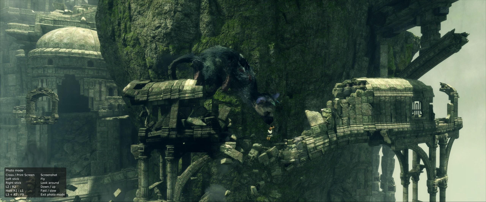</a></p>

<p align="center"><sub><i>Trico saving the day in the famous collapsing bridge scene. Normally only shown in first person, now it can be seen from all angles.</i></sub></p>

## Cut and hidden content

The game's scripts still contain things the developers built and then switched off or kept for
themselves. This port turns them back on. You won't find them in any other version of the game.
They are in the in-game menu (**Insert**, the **Extras** and **Trico Tricks** tabs).

> **[Read the full guide: everything we found and how to use it →](docs/extras.md)**

**Trico's drool.** The developers made it: the drool thickens when Trico smells something he
wants and thins out when he loses interest. Just before release it was switched off with one line
that is still in `condorcommonslaver.lua`:

```lua
	-- 一旦よだれを消してくれということなので消しておく
	do return end
```

*"We've been asked to get rid of the drool for now, so I'm getting rid of it."* You can set it to
**As the developers planned** or **Always**, in the launcher's Extras page or the Extras tab.

<p align="center"><a href="docs/extras.md#tricos-drool">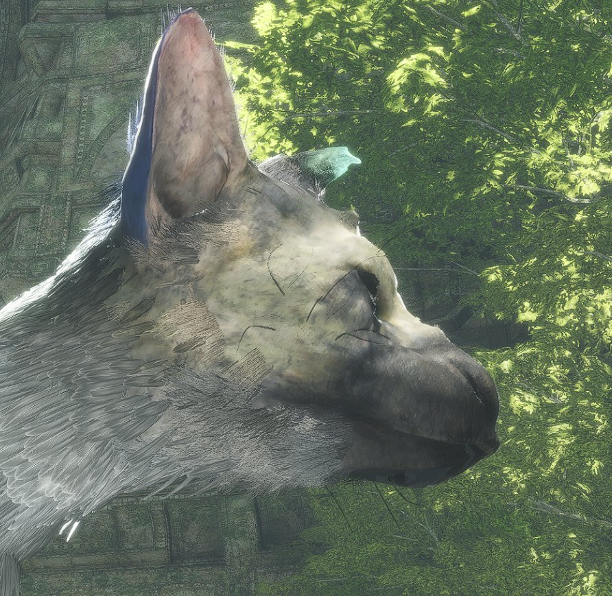</a> <a href="docs/extras.md#tricos-drool">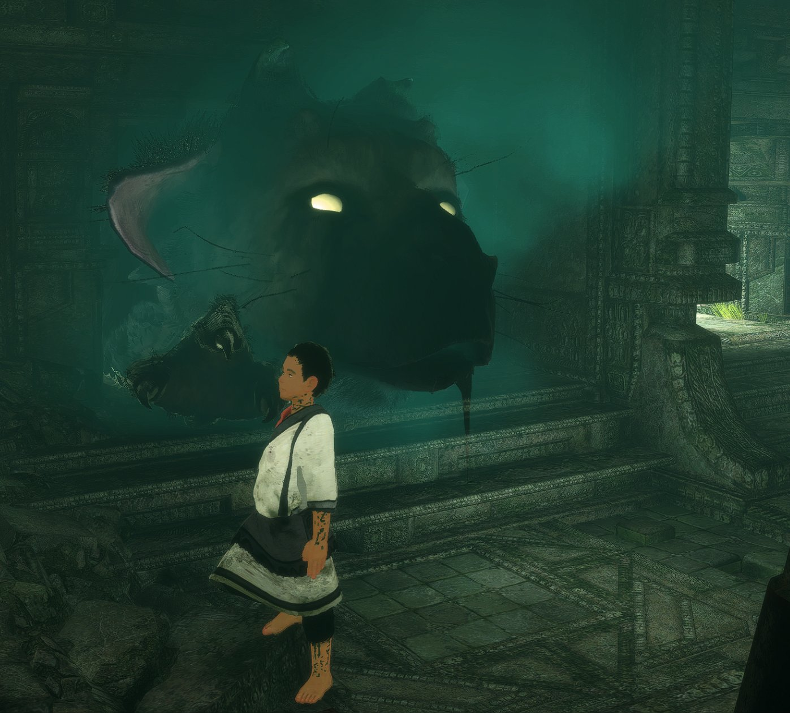</a></p>

### ICO horns, only in this port

The Horned Apparel finally gets its horns. One of the boy's
treasure outfits is the Ico one, and the game's own script calls it "the horned garment", but the
boy never had any. Now he does, just like Ico. Tick **ICO horns** on
the launcher's Extras page. They go with every outfit,
[more in the full guide](docs/extras.md#made-for-ico-fans-ico-horns).

<p align="center"><a href="docs/extras.md#made-for-ico-fans-ico-horns">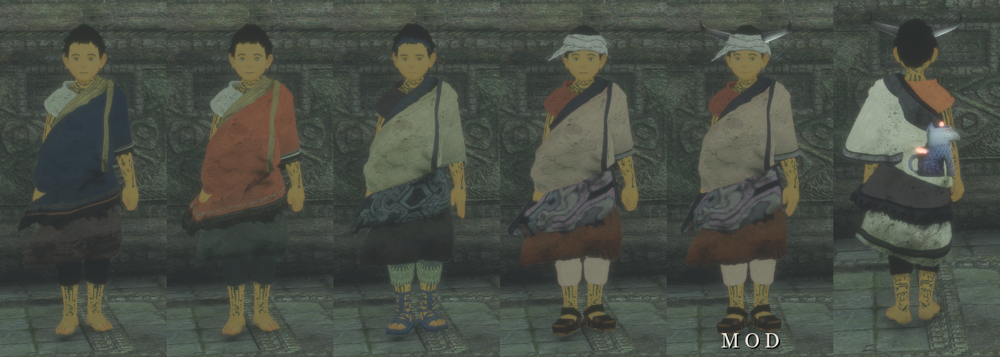</a></p>

### Foxtail toy, only in this port

In Japan, foxtail grass is called nekojarashi (猫じゃらし), "cat teaser": you wave a stalk in
front of a cat until it pounces. The developers planned that for the boy and Trico. Trico's script
still has the whole act, but the toy's model was cut and is not on the disc. For Trico's part we
use a pounce move that is still in the game; it looks like the one meant for this act, but we
can't prove it is. We made a new foxtail stalk, built on your PC by the
launcher like the ICO horns. Tick **Foxtail toy** on the launcher's Extras page, then use the gold
**Foxtail** and **Foxtail play** buttons in Trico Tricks,
[more in the full guide](docs/extras.md#the-foxtail-toy).

<p align="center"><a href="https://youtu.be/uQKJ5CMcbLg">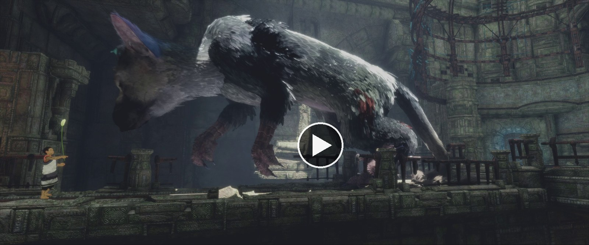</a></p>

<p align="center">▶️ <a href="https://youtu.be/uQKJ5CMcbLg"><b>Watch the video:</b> the foxtail toy and Trico's pounce</a></p>

More about the cut foxtail on the [Team ICO wiki](https://teamico.fandom.com/wiki/Unused_Content_%28The_Last_Guardian%29#Green_Foxtail_plant_%28nekojarashi%29).

**Trico's toilet.** Trico does need to go, but the game's scripts make sure you almost never see
it. He has to have eaten enough barrels, then 30 minutes of play must pass, then he waits until
the boy is more than 10 metres away and Trico's head has been out of the camera's view for 3
seconds. Look at him and the wait starts over. Most players only ever find the green dung balls
later, and the boy can pick them up and carry them. **Toilet** in the Trico Tricks tab skips all of
that: he goes right away, in front of you.

<p align="center"><a href="docs/extras.md#tricos-toilet">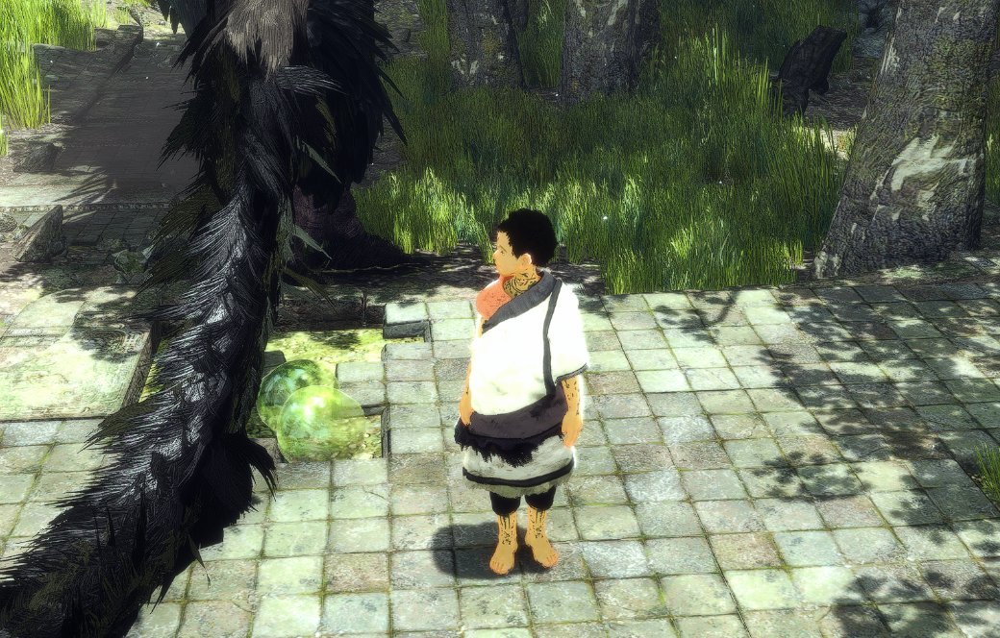</a> <a href="docs/extras.md#tricos-toilet">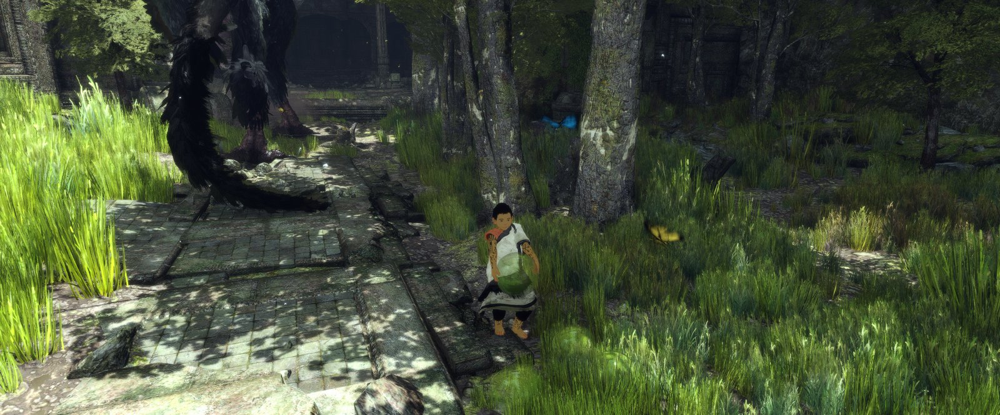</a></p>

The rest:

- **Trico Tricks** (**F12**): a bar with 49 of Trico's own moves in coloured groups, such as yawn,
  sneeze, roar, sit and roll over, the photo pose and lion roar of the press shots and E3 demos,
  plus the throw-up animation the developers sealed in July 2016. Right-click a move to add it to
  your favourites. 10 of them are in their own "May not work" group. Trico doesn't always listen.
- **Extra Tricos**: up to 8 more, including the armoured one.
- **Size:** from half to twice his size.
- **Coat:** fur and feather density from 50% to 250%, for a thin or a very fluffy Trico.
- **Eyes:** the hidden disco-eye effect, or any colour.
- **Free camera:** the developers' own camera.
- **Tricopilot:** the developers' test tool where Trico walks around by himself and the camera
  follows him.

<table>
  <tr>
    <td><a href="docs/extras.md#extra-tricos">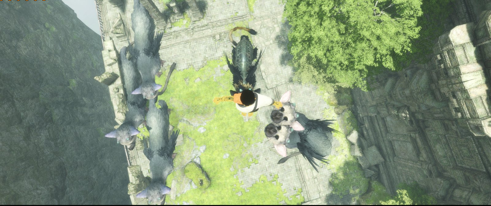</a></td>
    <td><a href="docs/extras.md#trico-tricks-make-trico-move">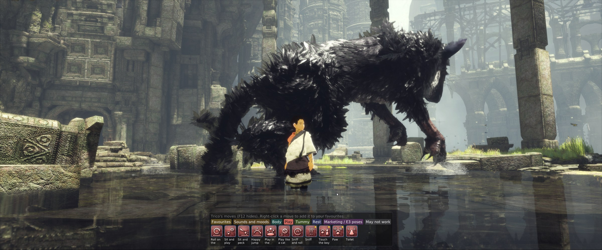</a></td>
    <td><a href="docs/extras.md#tricos-size">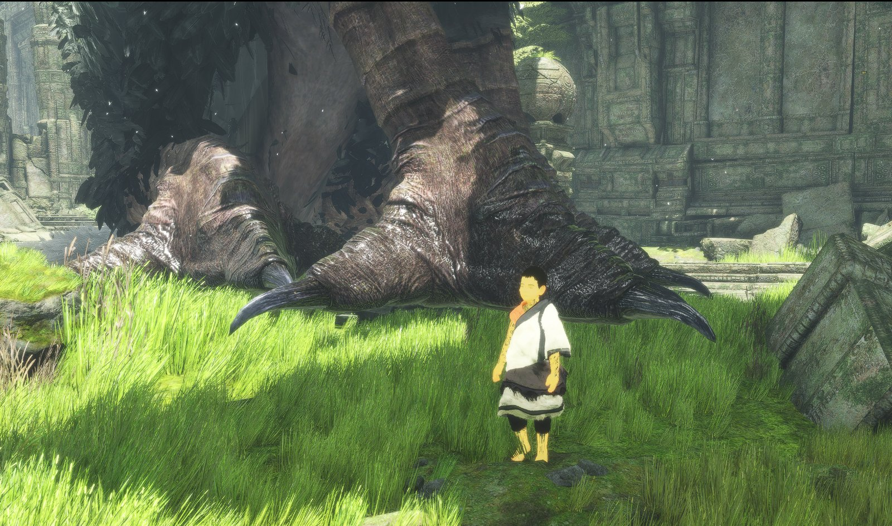</a></td>
  </tr>
  <tr>
    <td><a href="docs/extras.md#extra-tricos">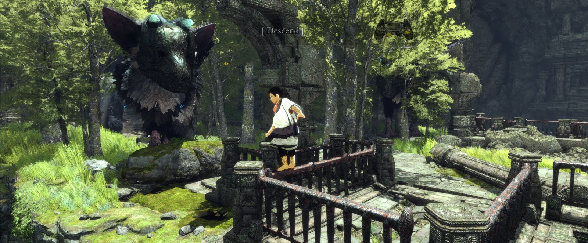</a></td>
    <td><a href="docs/extras.md#tricos-eyes">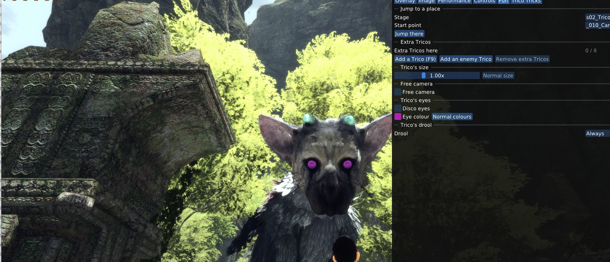</a></td>
    <td><a href="docs/extras.md#tricos-size">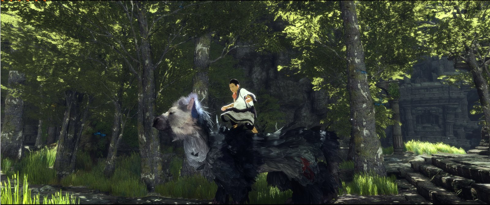</a></td>
  </tr>
</table>

<p align="center"><a href="docs/extras.md#tricos-coat">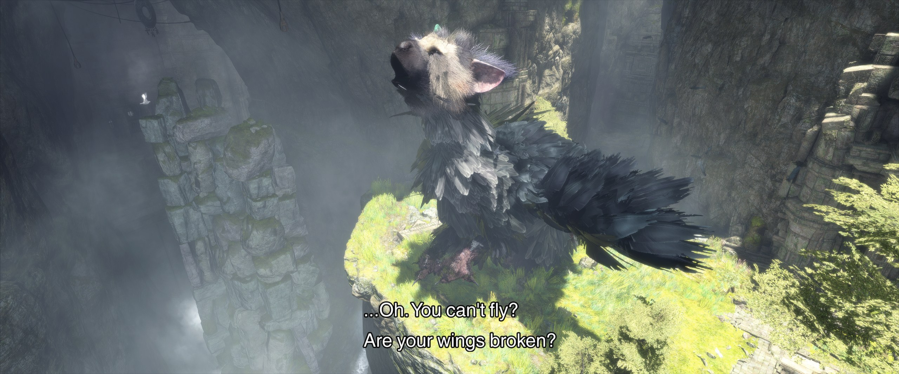</a></p>

**More is coming.** We are working on bringing back much more: content the developers cut, and
extras the game keeps locked behind its trophies.

<p align="center"><b><a href="docs/extras.md">More pictures, the full story behind each find, and how to use them: docs/extras.md</a></b></p>

## Sound

The game mixes in 7.1. Set Windows (or your Linux sound server) to 5.1 or 7.1 and every channel
goes to its own speaker; on a stereo device you get a stereo mix-down. In the launcher (Settings,
Audio) or the in-game menu (Controls, Sound) you can pick the **output device** and turn on
**Always send 7.1**: then a stereo headset gets all 8 channels, so Windows Sonic or Dolby Atmos for
Headphones turn them into headphone surround. Both apply at the next start.

## Soundtrack

The launcher's **Soundtrack** page plays all of the game's music from your own game files: 100
pieces, about 110 minutes, sorted by the stage where they play. Takeshi Furukawa's score was
recorded by the London Symphony Orchestra, London Voices and the Trinity Boys Choir. The music is
stored in surround, so you can choose 5.1 or a stereo mix-down. See [docs/soundtrack.md](docs/soundtrack.md).

<p align="center"></p>

## Controllers and languages

DualSense, DualShock 4 and Xbox controllers work out of the box, including rumble and the motion
sensor. On the launcher's **Controls** page you can remap buttons, set stick dead zones and
trigger points, check for stick drift, and remap keyboard and mouse. See
[port/packaging/README-player.md](port/packaging/README-player.md).

- **Xbox button icons:** with an Xbox controller the game's button hints and its Controls screen
  (Options > Controls) show an Xbox pad, with the glow on the right button, and the launcher's
  Controller page draws one too. **Button icons**
  (Controller page, or Controls in the port's menu) picks Automatic, PlayStation or Xbox;
  Automatic follows the controller you used last.
- **Hide button hints:** turns the game's button hint boxes off (issue #84). The tutorial still
  runs in the background, so nothing is skipped, and you can switch it while you play. Off by
  default; on the launcher's Controller page, or under Controls in the port's menu.
- **Quit from anywhere:** with the quit key on the keyboard (Ctrl+X; set your own or turn it off
  under Controls in the port's menu or on the launcher's Controller page: Ctrl or Alt with a letter
  or number, or an F key), or hold the quit combo for 2 seconds
  on a controller (a note shows while you hold; let go to cancel). The window's X and Alt+F4 work
  the same way. It quits the way the game's own Quit does, so settings and progress are saved.
  The game's pause menu (Options) shows your current buttons for quit, the port's menu and
  the QA menu.
- **Your own button combos:** the quit combo, the port's menu and the QA menu
  can each be set to other buttons, on the launcher's **Controller** page (Combos) or
  under Controls in the port's menu. The quit combo is always held for 2 seconds.

<p align="center">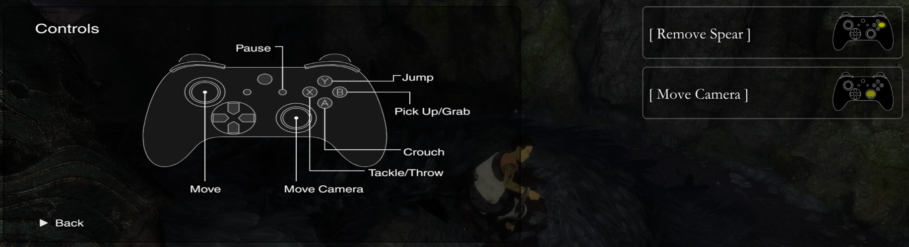</p>

<p align="center">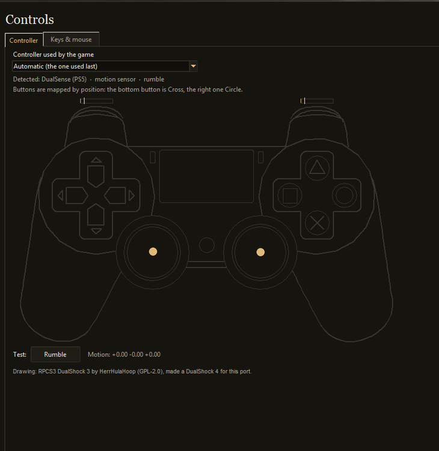 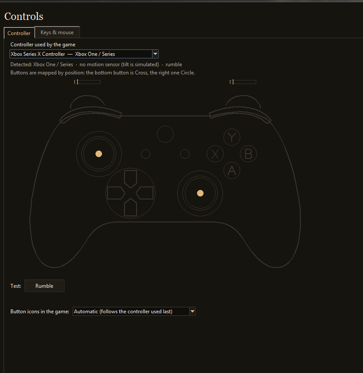</p>

The launcher and in-game menu are in English, with language packs for German, French, Spanish,
Italian, Dutch, Polish, Turkish, Ukrainian, Portuguese (Brazil and Portugal), Japanese, Korean and
Chinese (Simplified and Traditional) (**Settings > Language**). The Portuguese
pack is HayatoG's translation. The others are machine translations, and corrections from native
speakers are welcome; see [port/docs/language-packs.md](port/docs/language-packs.md). The game's
own text and voices are a separate setting.

## For testers

- **Jump to any scene:** over 200 start points, from the first cave to the credits. Pick one on
  the launcher's **Start at…** page (your saves are copied first and put back afterwards), or in
  game under Extras > *Jump to a place*.
- **Level select and QA menu:** tick *Level select and QA menu* under Debug in the launcher. For
  level select, hold L1 while the title menu closes. For the QA menu, hold L1 and press L3 in game
  (keyboard: hold 1, press Z). Based on the GoldHEN patch by @illusionyy and @DanielSvoboda; this
  port fixes the black screen and the video memory running out after a few stage switches. Their
  collapsing-bridge freeze fix is always on.
- **Scene check:** a script that visits all 219 start points and records FPS and a screenshot of
  each. See [docs/scene-check.md](docs/scene-check.md).

## Building

```bash
git clone --recursive https://github.com/tabnul/the-last-guardian-definitive.git && cd the-last-guardian-definitive
cd port && TLG_LTO=OFF bash build.sh
```

On Windows, run this in an MSYS2 CLANG64 shell; see
[port/packaging/windows/README.md](port/packaging/windows/README.md). DLSS also needs the DLSS SDK
(`build_dlss.sh`).

## Credits

Thanks to everyone whose work this builds on.

- [HayatoG/tlg_pc](https://github.com/HayatoG/tlg_pc): the original port. The loader, the
  runtime and most of what makes the game run at all is HayatoG's work.
- [gow3_pc](https://github.com/FelipePrado0/gow3_pc), [bloodborne_pc](https://github.com/deadinside28/bloodborne_pc)
  and the [shadPS4](https://github.com/shadps4-emu/shadPS4) video core.
- @illusionyy and @DanielSvoboda: the GoldHEN level select, QA menu and bridge fix patches.
- [kanjieater](https://github.com/kanjieater): Cross/Circle menu confirmation and the EU 1.03
  Japanese text option.
- Mike Lothian ([@FireBurn](https://github.com/FireBurn)): [UniversalScalers-Vulkan](https://github.com/FireBurn/UniversalScalers-Vulkan),
  which FSR 3.1, FSR 4 and FSR frame generation run on, and the open FSR 4 model files from his
  [Q2RTX](https://github.com/FireBurn/Q2RTX) builds (AMD FidelityFX SDK, MIT).
- Felipe Prado ([@FelipePrado0](https://github.com/FelipePrado0)): shipping the FSR 4 model in the
  packages follows his [SpartanPort](https://github.com/FelipePrado0/SpartanPort).
- Lucas Emiliano ([@devLucasEmiliano](https://github.com/devLucasEmiliano)): the start-up fix for
  DLLs loaded in the PS4 address range ([SpartanPort #1076](https://github.com/FelipePrado0/SpartanPort/pull/1076)).
- [LibAtrac9](https://github.com/Thealexbarney/LibAtrac9) for audio, and
  [vgmstream](https://github.com/vgmstream/vgmstream) for the sound bank layout.
- [4x-UltraSharp](https://huggingface.co/Kim2091/UltraSharp) by Kim2091 (CC BY-NC-SA 4.0), the
  default texture upscale model, and Microsoft's [DirectXTex](https://github.com/microsoft/DirectXTex).
- NVIDIA DLSS, under the NVIDIA DLSS license.
- Intel XeSS (`libxess.dll`, XeSS SDK 3.0), shipped unmodified under the Intel Simplified Software
  License (`XESS-LICENSE.txt`).
- Packed games (.zar): [ZArchive](https://github.com/Exzap/ZArchive) by Exzap (MIT-0), and the
  idea and design from [@R-V-L](https://github.com/R-V-L)'s ZArchive build of
  [gow3_pc](https://github.com/R-V-L/gow3_pc). Thanks to @dwaynevn-git for asking for it (#72).
- The controller drawing: the [RPCS3](https://github.com/RPCS3/rpcs3) DualShock 3 drawing by
  HerrHulaHoop (GPL-2.0), redrawn as a DualShock 4.
- Xbox button icons: the method (swap the game's pad pictures, move the glow) comes from
  [@SulphurS16](https://github.com/SulphurS16)'s [TLG-Port](https://github.com/SulphurS16/TLG-Port).
  Thank you! The Xbox pad drawing and the code are our own.
- Trophies: the idea, and checking the trophy key right away, also come from
  [@SulphurS16](https://github.com/SulphurS16)'s TLG-Port (#60). Our own code and chime.

## License

GPL-2.0, see [port/LICENSE](port/LICENSE).

This is an unofficial fan project. Sony Interactive Entertainment, SIE Japan Studio and genDESIGN
did not make, approve or sponsor it. "The Last Guardian" is a trademark of Sony Interactive
Entertainment. "The Definitive Edition" is our name for this port, not an official release. No
game code, files or art are included.
