# Extras

Features you will not find in any other version of the game. The game's files still hold things the
developers built and then cut, hid or kept for themselves: Trico's drool, his throw-up, disco eyes,
a free camera, test menus. We found them in the game's own scripts and brought them back to life,
together with a Trico you can boss around. All of it is optional and off until you use it. Nothing
here changes the story or your save on its own.

Open the in-game menu with **Insert** (or **R3 + L2** on a controller) and go to the **Extras** or
**Trico Tricks** tab.

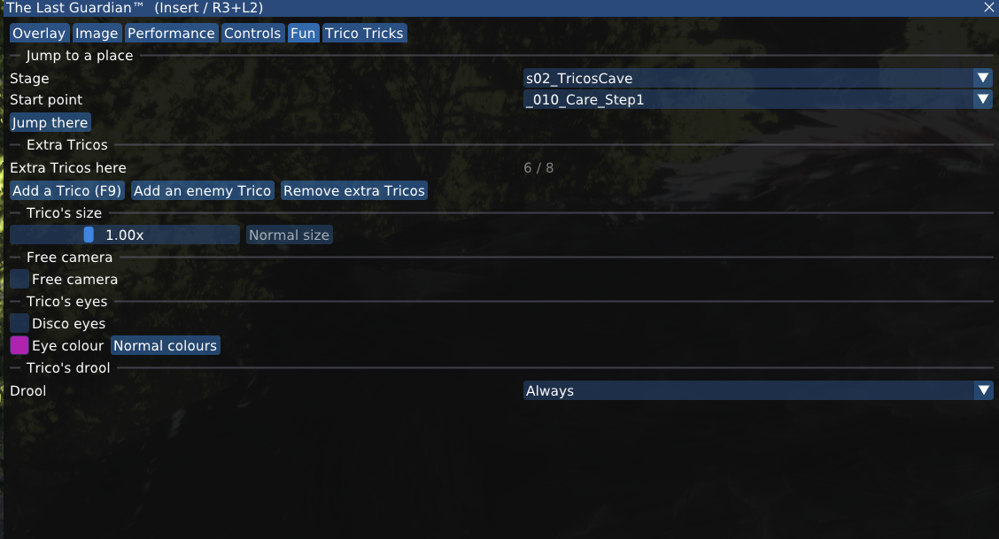

## Contents

- [Made for ICO fans: ICO horns](#made-for-ico-fans-ico-horns), only in this port
- [The foxtail toy](#the-foxtail-toy), cut by the developers, remade for this port
- [Trico's drool](#tricos-drool), a feature cut just before release
- [Outfits](#outfits)
- [Trico's size](#tricos-size)
- [Trico's coat](#tricos-coat), only in this port
- [Trico's helmet](#tricos-helmet)
- [Extra Tricos](#extra-tricos)
- [Trico's eyes](#tricos-eyes)
- [Photo mode](#photo-mode), only in this port
- [Free camera](#free-camera)
- [Tricopilot](#tricopilot), the developers' self-driving Trico
- [Trico Tricks: make Trico move](#trico-tricks-make-trico-move)
- [Trico's toilet](#tricos-toilet), something you almost never get to see
- [Jump to a place](#jump-to-a-place)
- [Keys](#keys)

## Made for ICO fans: ICO horns

Only in this port. One of the boy's treasure outfits, Horned Apparel, is the Ico one. The game's
own script calls it "the horned garment", yet the boy never had any horns. So we gave him a pair,
just like Ico.

<p align="center">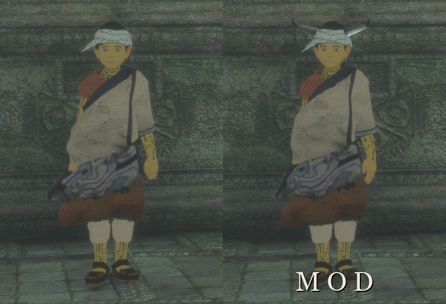<br><sub>Horned Apparel, before and after</sub></p>

Tick **ICO horns** on the launcher's Extras page. After that you can also switch them on and off in
the in-game menu. They go with every outfit, not only the Ico one.

We don't ship the horns as a file. When you tick the box, the launcher builds them on your PC: a
small script draws the shape, the colour and the hair tuft from scratch. Not a single byte comes
from the game disc, and there's no model file to pass around. If you never tick it, nothing is
built.

## The foxtail toy

Only in this port. In Japan, foxtail grass is called nekojarashi (猫じゃらし), "cat teaser": kids
pick a stalk and wave it in front of a cat until it pounces. The developers planned exactly that
for the boy and Trico. Trico's script still has the act for it (PlayToy, `PJT_CatToy` in
`intactcondor.lua`): the boy holds up a toy, waves it, claps, and Trico crouches and pounces.
The toy itself was cut before release. The script still asks for its model, `condorPlayToy_01`,
but that file is not on the disc. For Trico's part we use a crouch-and-pounce move that is still
in the game. It looks like the one meant for this act, but nothing in the files proves it is, so
treat it as our best match.

We made a new toy: a stalk of foxtail grass with a soft, nodding head. Like the ICO horns, the
launcher builds it on your PC from scratch, so nothing comes from the disc and there's no model
file to pass around. Tick **Foxtail toy** on the launcher's Extras page, once. Then two buttons
in the Trico Tricks bar, gold and at the end of the **Sealed and unique features** group, use it:

- **Foxtail:** the boy holds the toy until you press it again.
- **Foxtail play:** the full act. The boy picks up the toy, waves it at Trico and claps, and
  Trico pounces on it. Afterwards the toy goes away again.

**Play like a cat**, in the same group, is that pounce move on its own, without the toy.

<p align="center"><a href="https://youtu.be/uQKJ5CMcbLg">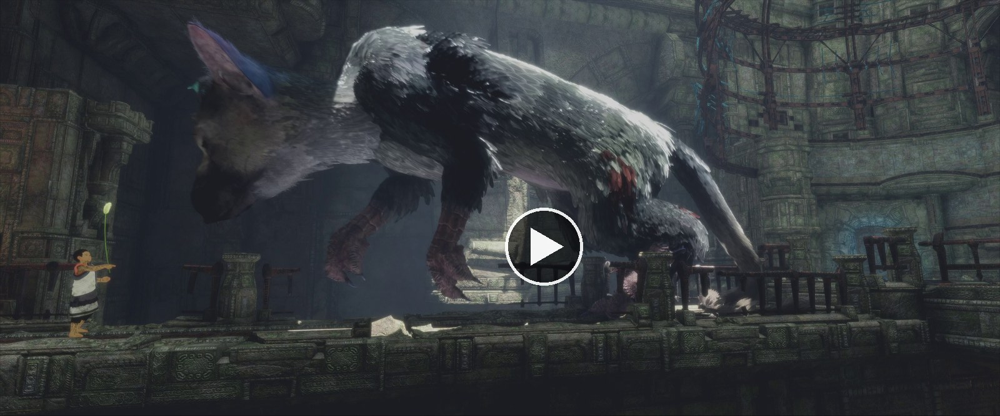</a></p>

<p align="center">▶️ <a href="https://youtu.be/uQKJ5CMcbLg"><b>Watch the video:</b> the foxtail toy and Trico's pounce</a></p>

More about the cut foxtail on the [Team ICO wiki](https://teamico.fandom.com/wiki/Unused_Content_%28The_Last_Guardian%29#Green_Foxtail_plant_%28nekojarashi%29).

## Trico's drool

The developers gave Trico drool, then switched it off just before release. The drool model, its
material and all the logic are still in the game files. In the script `condorcommonslaver.lua` the
code runs right up to the point where it would show the drool, and then stops:

```lua
	-- 一旦よだれを消してくれということなので消しておく
	do return end
```

*"We've been asked to get rid of the drool for now, so I'm getting rid of it."*

"For now" lasted until this port, which brings it back.

- **Always:** a string of drool hangs from Trico's beak the whole time.
- **As the developers planned:** the drool slowly grows while Trico smells something he wants, a
  smell-pot cart (s04_FirstAntenna and s10_Pit), and fades away when he loses interest. The boy's
  smell bottle was meant to do this too, but it was cut, so the carts are the only trigger.

Set it in the launcher on the **Extras** page, or in game on the Extras tab. A change works at once,
also while you play, and the choice is kept for the next start. Off by default.

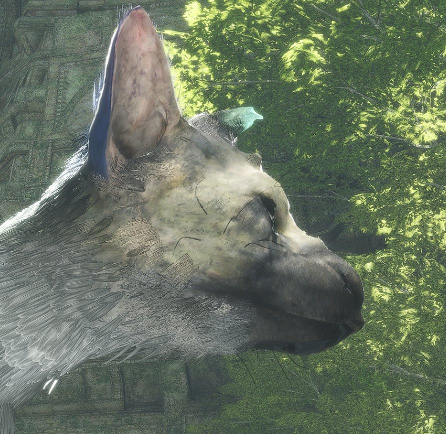
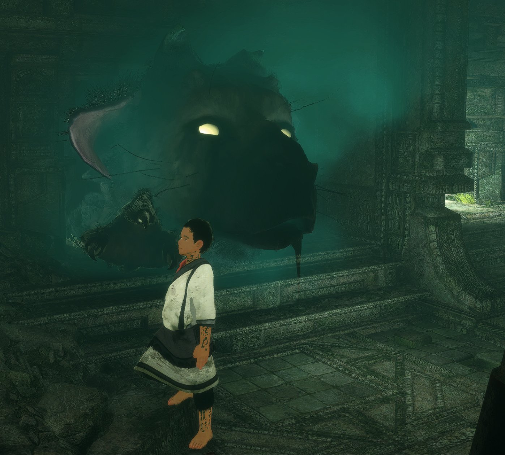

## Outfits

Find the treasures and the boy gets new clothes. Add the [ICO horns](#made-for-ico-fans-ico-horns)
to any of them.

<p align="center">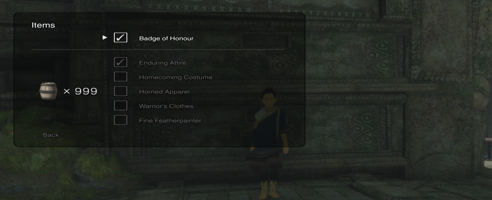</p>

<p align="center">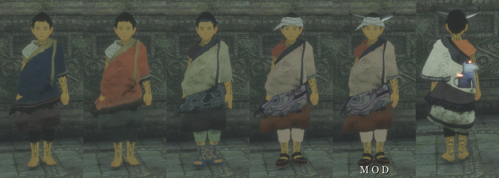</p>

<p align="center"><sub>Enduring Attire · Homecoming Costume · Warrior's Clothes · Horned Apparel · Horned Apparel + ICO horns · the Fine Featherpainter on his back</sub></p>

Trico gets one too: the **Badge of Honour**, around his neck. He may not have earned it yet, but he
sure can wear it in our port.

<p align="center">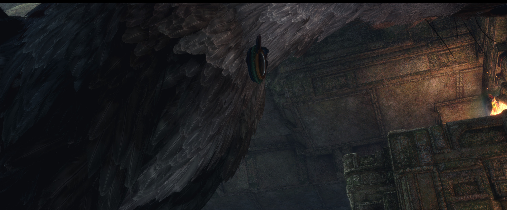</p>

## Trico's size

Makes the story's Trico bigger or smaller, from half to twice his normal size. A big Trico may not
fit through narrow spots: make him normal again (**Normal size**) to pass. A jump or a new stage
brings back his normal size.

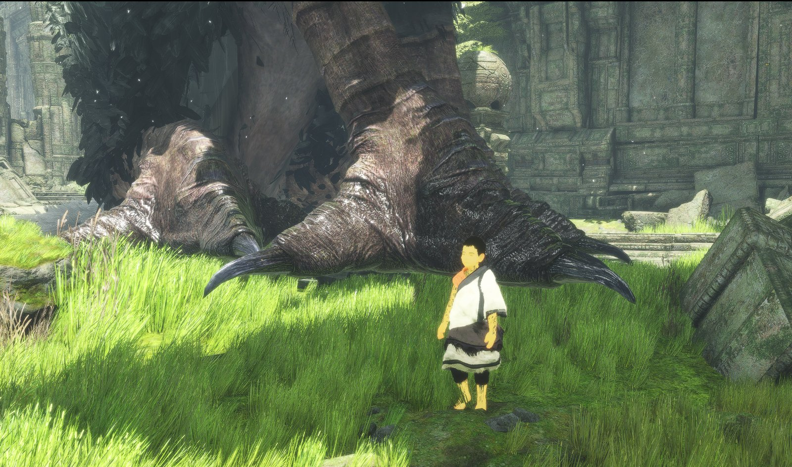
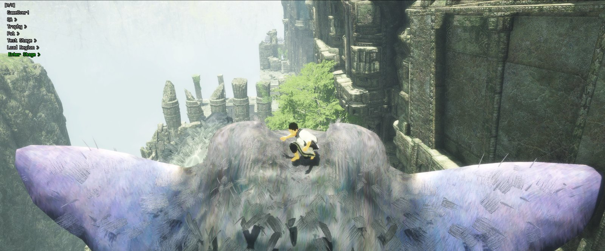
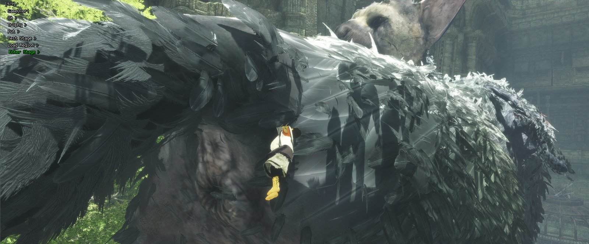
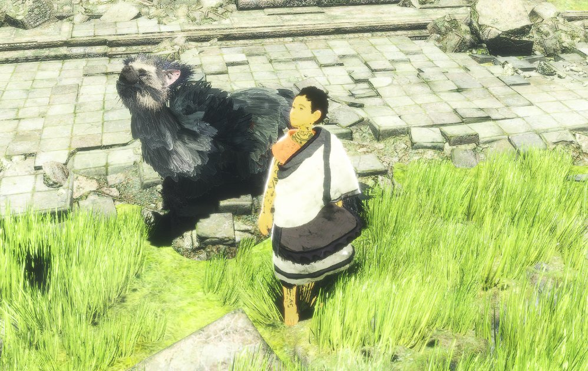
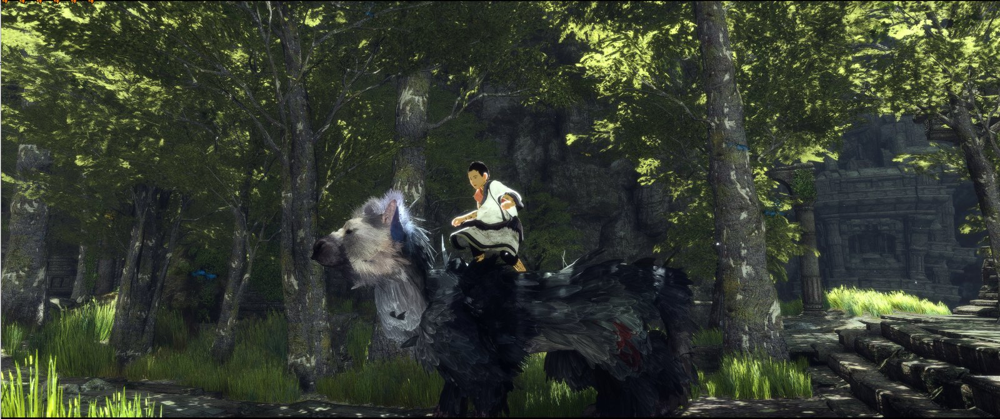
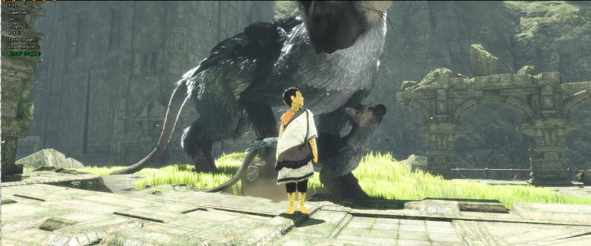

## Trico's coat

Makes Trico's fur and feathers thicker or thinner: **Trico fur and feather density** in the
port's menu (**Insert**), Extras tab, or on the launcher's Extras page. 100% is as the game shipped
(default and recommended), up to 250% gives a very fluffy Trico, down to 50% a thin one. It
changes while you play and is kept for the next start. Just for fun.

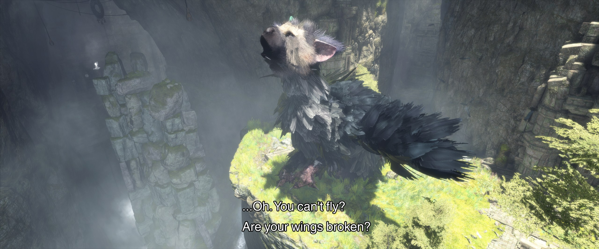

<sub>No, he is just too feathered to fly.</sub>

## Trico's helmet

The game has three helmets for Trico: the armour helmet of the armoured Tricos, a broken one, and
the mask of the other Trico. In the story he only wears one in a few cutscenes. Pick one under
**Trico's helmet** (launcher Extras page, or the Extras tab in game) and he keeps it on for the whole
game. **No helmet** takes it off for good, cutscenes included. The default, **As in the story**,
changes nothing.

The story sets Trico's look about 30 times: horns, tail, wings, dirt and helmet. We only swap the
helmet, so the rest still follows the story. Extra Tricos keep their own helmet.

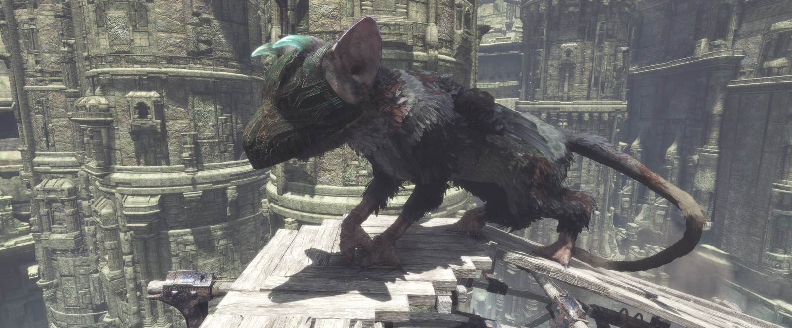

## Extra Tricos

Adds more Tricos next to the boy (**Add a Trico**). **Add an enemy Trico**
brings in the armoured one from later in the story, a bit further away. **Remove extra Tricos**
takes them all away again.

At most 8 extra: with more, the game's physics runs out of room and the game crashes. They are for
fun only: they do not follow the story and can block the way. A jump or another stage ends them.

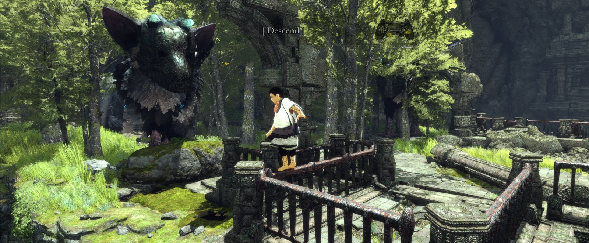

## Trico's eyes

- **Disco eyes:** Trico's eyes keep changing to random colours. This is the game's own hidden
  effect, normally only seen in a few story moments.
- **Eye colour:** pick any colour yourself. **Normal colours** brings the normal eyes back.

A jump turns the effect off.

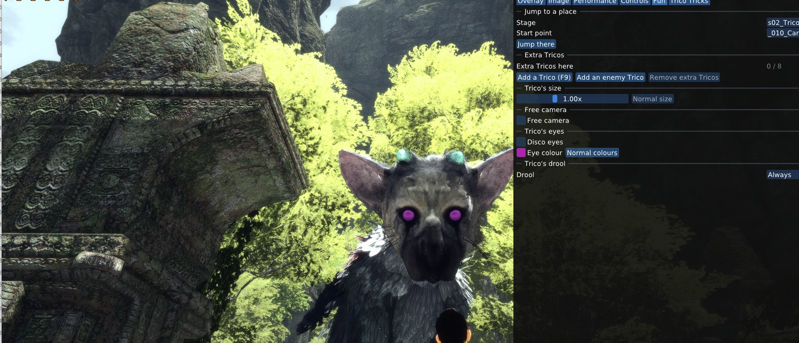

## Photo mode

The original game has no photo mode; this port adds one. The world stops (the game's own pause) and
you fly a free camera wherever you want, then save the picture. The button help in the bottom left
shows the controls and is left out of the saved picture.

| Button | What it does |
|---|---|
| L3 + R3, or F9 | Photo mode on and off (the combo can be changed in the menu, Controls) |
| Left stick | Fly forward, back, left and right, in the direction you look |
| Right stick | Look around |
| L2 / R2 | Down / up |
| Hold R1 / L1 | Faster / slower |
| Cross, or Print Screen | Save a screenshot |
| D-pad down | Freeze world on / off: let the world run on under your camera, or freeze it again |
| D-pad left | Sticks: camera / boy: control the boy while the photo camera stays put, or fly the camera again |
| D-pad up | Hide / show the button help |

Screenshots are lossless PNG files at the full render resolution, in `user/screenshots`. With HDR
on, every photo is saved twice: a normal picture that looks right on any screen, and an HDR picture
(name ending in `-hdr.png`) for HDR screens; **Also save an HDR picture** in the Extras tab switches
the second one off. You can
also turn photo mode on with **Photo mode** in the Extras tab. **Freeze** chooses how the world
stops: **Pause the game** (everything stops) or **Stop time** (the game's slow motion turned down
until nothing moves). With **Freeze world on / off** (D-pad down) the world runs on while you keep
the photo camera, so you can watch events play out from any angle. The game's pause menu does not undo
the freeze: closing it freezes the world again. **Sticks: camera / boy** (D-pad left) gives the
controller to the boy while the camera stays put, so you can play a moment and film it from your own
angle; then only Print Screen takes a picture. While the sticks are on the camera, the boy stands
still. All
photo buttons can be changed in the menu (Controls) and in the launcher. A jump to another place
turns photo mode off.

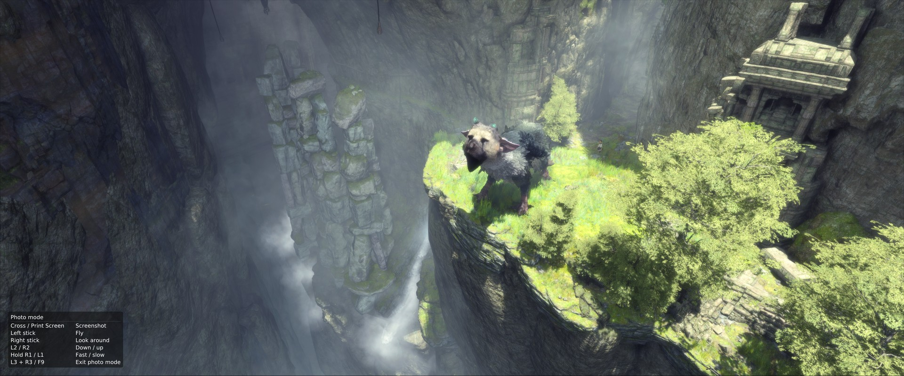

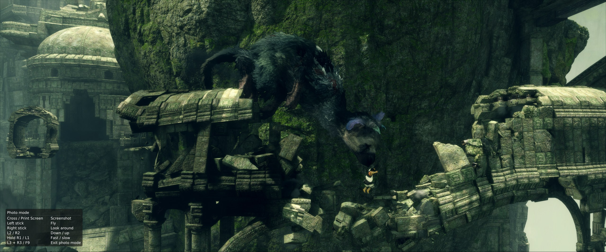

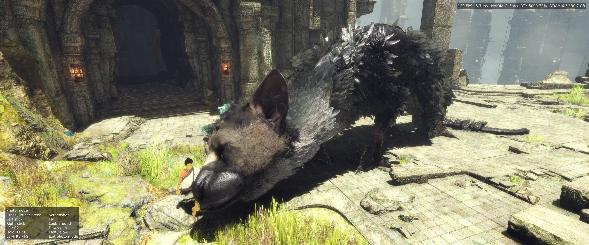

## Free camera

The developers' own camera: it lets go of the normal camera that follows the boy, so you can look
at the scene from anywhere. Turn it off to get the normal camera back. A jump or a new stage turns
it off.

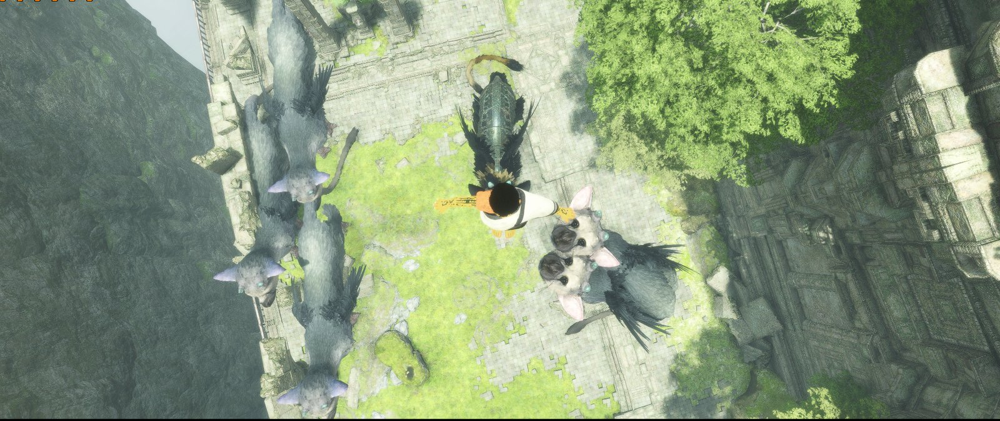

## Tricopilot

**Start Tricopilot** in the **Extras** tab and Trico drives himself: he wanders the scene, looks for
edges to climb or jump, and the camera follows him around. **Stop Tricopilot** gives him and the
camera back to you.

It is not ours. It is the developers' own debug tool, `condordebugautotrico.lua`, still sitting in
the retail game's scripts. They used it to leave the game running by itself for hours while they
watched for crashes: the same file can walk Trico on to the next scene when he is done with this
one, and it knows every stage's start points — their own version of the scene sweep this port uses
for testing. Three leftovers in it say how old it is: a line that restarts the game over a network
socket from a PC called `D:\trico`, a camera preset named `TricoAutoRunTest_middle`, and helper
volumes that are not on the disc any more. The game quietly skips those missing volumes, which is
why Trico sometimes picks an odd route.

**Camera.** The top-down view is the developers' own chase preset, and their tool has three of
them. The **Camera** box next to the Start button picks which one watches him, also while he is
already driving:

- **Near** keeps Trico big in the picture. The best of the four in open scenes.
- **Middle** is what their tool picks itself (`TricoAutoRunTest_middle`): the classic top-down
  view. In a narrow or roofed place the camera can end up inside the rock — in
  s13_FirstFlight `_005_Garden` (mission `FF_b01_EnterGarden`) it does exactly that, while Near
  frames him cleanly.
- **Far** looks down on the whole area. Lovely in a valley, useless indoors: Trico becomes a dot.
- **Game camera** leaves your normal camera alone. It keeps following the boy while Trico wanders
  off on his own.

The game switches the tool off outside the developers' editor, so the port switches it back on
(`DEBUG_AUTO_TRICO`) and waits for Trico to exist before starting him, which is what makes it work
right after a load.

For fun only: Trico ignores the story while he drives, he can wander into water or into a load
trigger, and the story keeps running around him. The launcher's benchmark can keep Tricopilot on
for a whole run (**Debug > Benchmark**, "Let Trico drive"), so the scenes are measured with him
moving instead of standing still. The same four cameras are in the box next to it; the camera only
changes what you see, not what is measured. Those numbers are not comparable with runs without
Tricopilot; the report notes which it was, and which camera.

## Trico Tricks: make Trico move

The **Trico Tricks** tab makes the story's Trico sneeze, yawn, roar, howl, flap or stretch his
wings, scratch, shake off water, sit, lie down, roll on the ground and more. Some moves need room:
a roll can push the boy off a ledge.

- **The bar:** press **F12** in game to get the moves as a small bar over the game (the same bar
  is on the Trico Tricks tab), and click a move. Coloured buttons on top pick a group, in the
  colours of the icons: Sounds and moods, Body, Play, Tummy, Rest, Marketing / E3 poses and May
  not work. The bar opens on the group you used last.
- **Favourites:** right-click a move to add it to the **Favourites** group, the first button (in
  the menu also Square / X on a controller). A gold star marks it; right-click again to take it
  out. Up to 16, kept in `user/tlg.ini` (`trico_favourites`).
- **Marketing / E3 poses:** poses from the game's press shots and E3 demos: **Photo pose**,
  **Claws** and **Lion roar**.
- **May not work:** 10 moves we never saw working in our tests (Fall asleep, Dig sand, Hungry and
  others). They have their own group; try them.
- **Gag** and **Throw up:** the throw-up is a cut animation, sealed by the developers in July 2016.
  This brings it back.
- **Sealed and unique features:** moves the developers sealed, such as **Play like a cat**, and
  at the end, in gold, **Foxtail** and **Foxtail play**, which only this port has. See
  [The foxtail toy](#the-foxtail-toy).

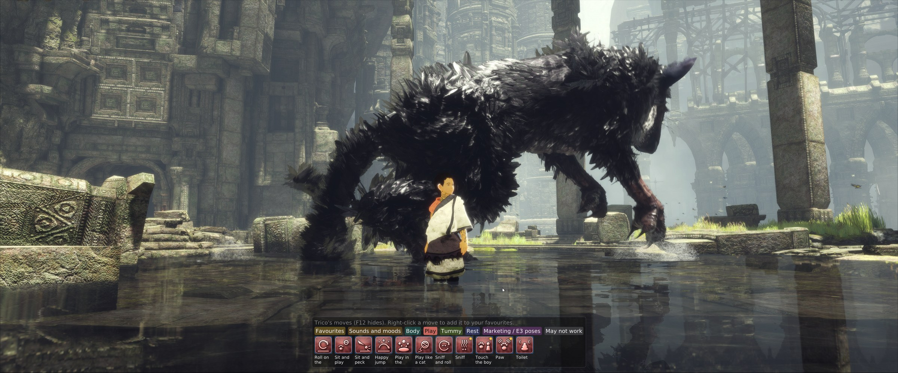

## Trico's toilet

Trico does need the toilet in the game, but the game makes sure you almost never see it. From its
own scripts (`condorcommonactioneatable.lua`, `gamework.lua`), all of these must be true:

- His stomach has emptied at least **2 times** since his last time. That happens after he eats
  barrels: the game counts it as throwing up, even with the throw-up animation cut.
- Then **30 minutes** of normal play pass. Cutscenes and standing in water don't count.
- Then he waits for a moment when the boy is **more than 10 metres away**, there is room, and
  **Trico's head is out of the camera's view for 3 seconds**. Look at him and the wait starts
  over.
- If that moment doesn't come within **10 minutes**, the urge passes and the count starts again.

So in normal play you mostly find the result later, if at all: green dung balls on the ground. The
boy can pick them up and carry them (second picture).

**Toilet** in the Trico Tricks tab skips all of that: he does it right away, in front of you.

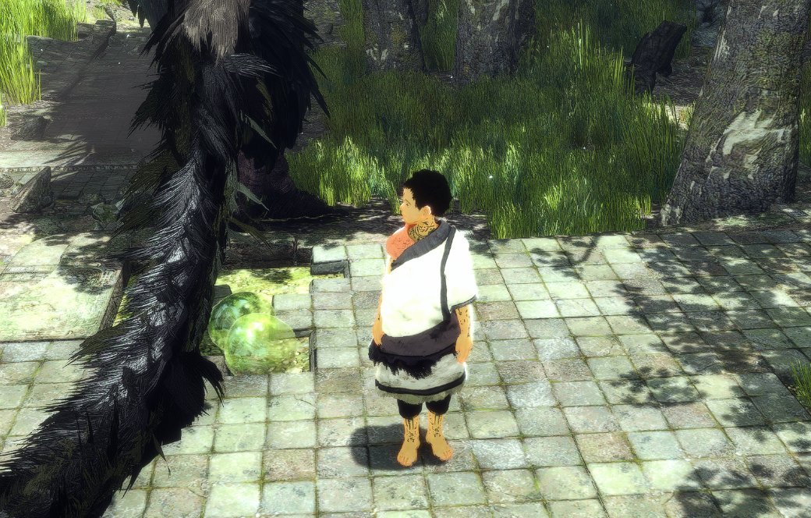
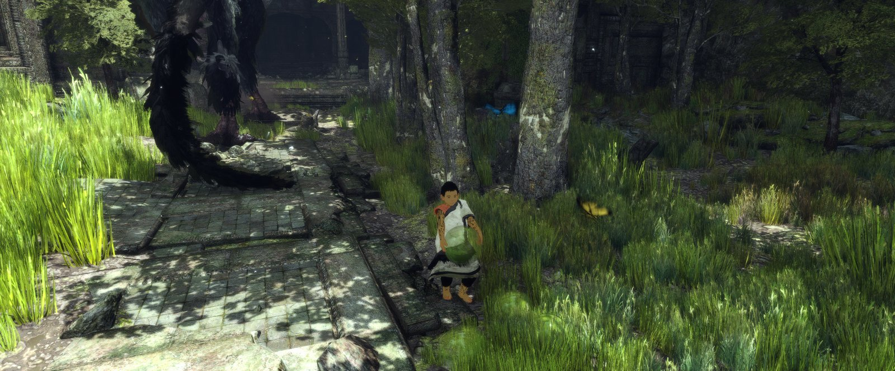

## Jump to a place

Starts any stage at any of its start points, as the game's own level select does.

- **In game (Extras tab):** pick a stage and a start point, then **Jump there**. The story continues
  from there, and the game can save there at its next checkpoint: keep a copy of your save
  (launcher: Saves folder) if you want to go back.
- **In the launcher (Start at…):** starts the game right at the chosen point. Your saves are copied
  before the game starts and put back when it closes, so nothing from that run is kept.

The game's own level select and debug menu (launcher, Settings → Debug) come from the patches of
@illusionyy and @DanielSvoboda. Thank you both.

## Keys

| Key | What it does |
|---|---|
| Insert (R3 + L2) | Opens the in-game menu |
| F9 (L3 + R3) | Photo mode on and off |
| Print Screen (Cross) | Saves a screenshot in photo mode |
| F12 | Shows or hides the Trico Tricks bar |
| F10 | Shows or hides the FPS counter |
